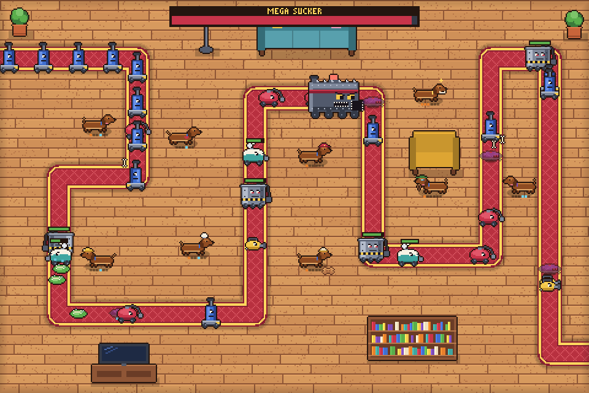

<div align="center">

# Dachshunds vs Vacuums

**A pixel-art tower defense where brave dachshunds throw bones at an army of vacuum cleaners.**

**English** · [Polski](README.pl.md)

### [▶ Play in your browser](https://xmichsenx.github.io/doxie-tower-defense/)



[](https://github.com/xmichsenx/doxie-tower-defense/actions/workflows/deploy.yml)

</div>

The vacuums want to suck up the dog bed. Seven dachshunds stand in their way, each with its own trick and two upgrade paths. Survive 40 waves, beat the MEGA SUCKER, then keep going in endless mode.

## Features

- **7 dachshunds:** Thrower, Sniper, Digger, Barker, Chef, Firefighter and Baker. Each has 2 upgrade paths with 3 levels. Once one path reaches level 3, the other is capped at level 1.
- **8 vacuums:** destroying a big one makes smaller ones fall out of it. The roster includes fast robots, camouflaged shadow robots, armored industrial vacuums, water-proof steam cleaners and the MEGA SUCKER boss.
- **3 maps:**
  - **Living Room:** a long, winding rug.
  - **Kitchen:** a shorter route where furniture takes up space.
  - **Garden:** two paths at once, with a shared lane in the middle.
- **Game modes:** 3 difficulty levels, 40 waves plus endless mode, ×1/×2/×3 speed, auto-start and target modes.
- **Art and sound:** everything is drawn and synthesized in code (pixel art, 8-bit sound effects). There are no image or audio files.
- **Languages:** English and Polish, switchable in the main menu.

## Controls

| Key / action | What it does |
|---|---|
| **1–7** then click | Pick and place a dachshund (Shift + click places several) |
| Click a dachshund | Upgrade, change target, sell |
| **Space** | Start a wave (during a wave: change speed) |
| **F** | Game speed ×1 / ×2 / ×3 |
| **Tab** | Cycle target mode of the selected dachshund |
| **Delete** | Sell the selected dachshund |
| **P** / **Esc** | Pause |
| **M** | Mute |
| Right click / **Esc** | Cancel |

Click the Baker's cookies to collect them right away.

**On a phone** the game switches to a portrait layout, with the map on top and the shop and upgrades below. Drag a dachshund from the shop onto the map and let go to place it. The preview floats above your finger so you can see where it lands, and a red range means it can't go there. Tap a dachshund to upgrade or sell it, and tap cookies to collect them.

## Run locally

```bash
npm install
npm run dev        # http://localhost:5173
```

| Command | Description |
|---|---|
| `npm test` | Run the test suite (Vitest) |
| `npm run coverage` | Tests with a coverage report |
| `npm run typecheck` | Type-check |
| `npm run build` / `npm run preview` | Production build in `dist/` |

Add `?debug` to the URL for lots of money, a wave jump, hitboxes (H) and `window.app` in the console. A balance bot lives in [`tools/bot.ts`](tools/bot.ts): `(await import('/tools/bot.ts')).runBot('ogrod', 'normal')`.

## How it's built

TypeScript (strict), Vite and the Canvas 2D API. There is no game engine and no UI framework.

- `src/core`: math, paths, seeded RNG
- `src/data`: dachshunds, vacuums, maps and waves (plain data)
- `src/sim`: all game logic. It has no DOM and is deterministic (fixed 1/60 s step), so it is fully testable.
- `src/render`: pixel-art sprites built from code, renderer and effects
- `src/ui`, `src/audio`, `src/i18n.ts`, `src/app.ts`: interface, sound, translations and the game loop
- `tests/`: unit tests and headless simulation tests

Every push to `main` is tested and deployed to GitHub Pages by [`.github/workflows/deploy.yml`](.github/workflows/deploy.yml).
